<div align="center">



<br>

[](https://madrays.de)
[](https://github.com/madrays?tab=followers)
[](https://github.com/madrays?tab=repositories&sort=stargazers)
[](https://github.com/madrays)

</div>

<br>

```yaml
whoami:
  handle:   madrays
  habitat:  NAS · Docker · 自托管
  doing:    给顺手在用的服务写插件和小工具，写到自己满意为止
  loves:    把家里的设备串起来 —— 曲库、影音、面板、音箱
```

<br>

## ✦ 在做的东西

<table>
<tr>
<td width="50%">
<a href="https://github.com/madrays/trackferry"></a>
<p align="center">


</p>
</td>
<td width="50%">
<a href="https://github.com/madrays/sun-panel-helper"></a>
<p align="center">

<a href="https://github.com/madrays/helper-docs"></a>
</p>
</td>
</tr>
<tr>
<td width="50%">
<a href="https://github.com/madrays/MoviePilot-Plugins"></a>
<p align="center">

</p>
</td>
<td width="50%">
<a href="https://github.com/madrays/nexusphpplugin"></a>
<p align="center">
<a href="https://github.com/madrays/nexusphp-fortune-wheel"></a>
<a href="https://github.com/madrays/nexusphp-bank-system"></a>
</p>
</td>
</tr>
</table>

<br>

## ✦ 手边的家伙

<p align="center">

</p>

<br>

## ✦ 提交轨迹

<picture>
  <source media="(prefers-color-scheme: dark)" srcset="https://raw.githubusercontent.com/madrays/madrays/output/snake-dark.svg">
  <source media="(prefers-color-scheme: light)" srcset="https://raw.githubusercontent.com/madrays/madrays/output/snake.svg">
  
</picture>

<br>

<div align="center">
<sub>写给自己用的东西，顺便也给你用 · 觉得有用就点个 ★</sub>
</div>
